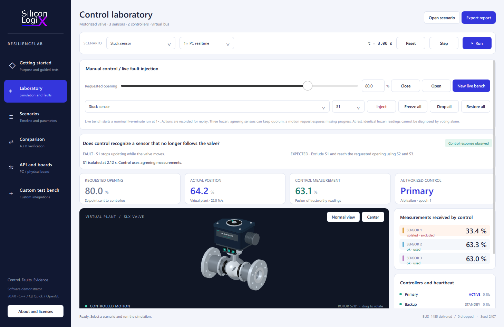

<!-- Copyright (c) 2026 Marco Pezzullo / Silicon LogiX. License: see LICENSE. -->
# SLX ResilienceLab

**Silicon LogiX - From fault to evidence.**

SLX ResilienceLab is a desktop software demonstrator for testing how redundant control reacts to sensor, controller, actuator and communication faults. A motorized valve, three sensors and primary/backup controllers execute a repeatable simulation. Decisions come from C++ logic and transported messages.

Use it to investigate a control algorithm before physical tests and replay the same failures after changing the code. Compare position errors, detection times, takeovers and motion stops. Silicon LogiX can adapt the plant, protocols, algorithms and acceptance criteria to a customer's product.



## Run the desktop

Download the [Windows x64 portable package](https://github.com/Silicon-Logix/slx-resiliencelab/releases/download/v0.4.0/SLX-ResilienceLab-0.4.0.zip) from the [0.4.0 release](https://github.com/Silicon-Logix/slx-resiliencelab/releases/tag/v0.4.0), extract the ZIP, and open the executable. The release also provides SHA-256 checksums. The package includes runtime licenses and corresponding dependency sources.

Open **slx-resiliencelab.exe** in the Windows x64 portable package. No Qt or Python installation is required. The renderer needs an OpenGL 3.3 driver.

- **Getting started:** run the stuck sensor, primary loss or measurement loss test. Each lasts 12 simulated seconds. Guidance reports observed results, including failed criteria.
- **Laboratory:** change requested opening, move the 3D camera, inject faults and inspect readings, fused measurement, control ownership and events.
- **New live bench:** start a nominal five-minute session at 1x. Close/open the valve, enter a target, freeze/disconnect/restore all sensors, and export evidence. Manual actions are recorded for replay.
- **API and boards:** load an executed customer DLL, connect USB serial, enable the local TCP API and read the position through the actual transport.
- **Scenarios / Comparison:** edit parameters and timelines, preserve the seed, and compare two control versions.
- **Custom test bench:** view commissioned integrations and save a technical inquiry locally.

1x follows the PC clock; 0.5x slows observation and 4x accelerates the demo. Batch runs ignore wall time. Desktop execution is soft realtime, with measured lag, and does not guarantee hardware deadlines.

Three agreeing frozen sensors can keep measurement quorum. A motion request exposes missing measured progress and triggers a latched stop. Frozen sensors at rest cannot be identified by voting alone. [Live API and fault behavior](docs/bench-api.md).

## Customer integration

The flow is **simulated plant -> received measurements -> customer control -> motor command -> simulated plant**. The C ABI executes a customer DLL on the PC and replaces motor-command calculation. Sensor fusion, heartbeat and arbitration remain in the SLX host.

The implemented USB serial/TCP API can read state or measurements, request an opening and control the bench. It does not yet replace the host algorithm with physical firmware motor commands. Full firmware-in-the-loop control, electrical I/O, calibrated product models and a dedicated realtime target require a customer-specific integration. [SDK](docs/sdk.md) - [Integration guide](docs/customer-integration.md).

## Build and batch

The approved Windows kit is Qt 6.12.0, including Serial Port, and MinGW GCC 13.1.0. The full development checkout builds the proprietary core. A distribution checkout imports the compiled ABI-compatible SDK; its core source is excluded.

```powershell
powershell -ExecutionPolicy Bypass -File scripts/build-windows.ps1
python tools/prepare-runtime-sources.py
powershell -ExecutionPolicy Bypass -File scripts/package-windows.ps1 -CreateArchive
```

```text
slx-resiliencelab.exe --run --scenario scenarios/sensor-stuck.json --report report.html
slx-resiliencelab.exe --suite --plugin SLX.CustomerController.Example.dll --report campaign.html
slx-resiliencelab.exe --live --api
slx-resiliencelab.exe --live --serial COM3 --baud 115200
```

Reports contain standalone HTML, full JSON and sample CSV. A campaign links three complete reports and preserves the customer DLL hash. Exit codes: 0 all criteria pass, 1 an acceptance criterion fails, 3 loading/export error.

## Components and license

`src/` and `qml/` contain the desktop, rendering, transports and reporting. `core/include/slx/` contains public interfaces; `examples/` contains customer DLL, PC API and board clients. `scenarios/` contains three repeatable experiments. The compiled proprietary core implements the plant, sensors, controllers, bus, faults and recording.

Copyright (c) 2026 Marco Pezzullo / Silicon LogiX. Distributed under the [Silicon LogiX Evaluation License 1.0](LICENSE). Publicly visible source is evaluation-licensed; it is not an unrestricted open-source grant. Qt and compiler runtimes retain their separate licenses. The portable package includes replaceable DLLs, notices and corresponding sources. [Distribution](docs/distribution.md).

This is a **software demonstrator without safety certification or physical hardware validation**. The plant is a simplified kinematic model, the gateway is idealized, and customer DLLs execute in the desktop process. [Validation](docs/validation.md) - [Quick start](docs/quick-start.md) - [Architecture](docs/architecture.md).

Contact [Silicon LogiX](https://www.siliconlogix.it/contatti) for a test bench adapted to your product.
